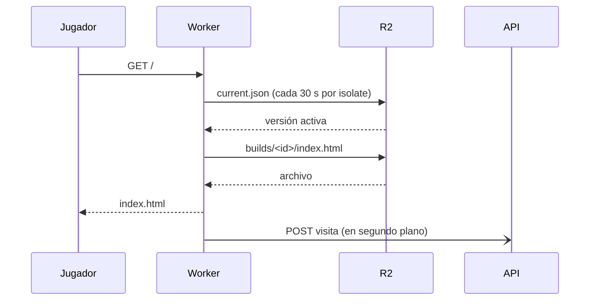

# Earthcation, servidor del juego

Cloudflare Worker que sirve el juego WebGL de Earthcation en `play.earthcation.saimers.dev`. Earthcation es un Juego
Serio para reforzar la identificación de riesgos en la labor minera subterránea de carbón en Norte de Santander.

El Worker no contiene el juego: lo lee de un bucket privado de R2 donde la API (`earthcation_be`) publica cada versión
y decide cuál está activa. Así publicar o volver a una versión anterior no requiere desplegar el Worker.

Proyecto del Semillero VIRAL de la Universidad Francisco de Paula Santander (UFPS), desarrollado como trabajo de grado
de Ingeniería de Sistemas.

## Contenido

1. [Cómo funciona](#cómo-funciona)
2. [Arquitectura](#arquitectura)
3. [Requisitos y puesta en marcha](#requisitos-y-puesta-en-marcha)
4. [Configuración](#configuración)
5. [Pruebas y calidad](#pruebas-y-calidad)
6. [Despliegue](#despliegue)
7. [Decisiones de diseño](#decisiones-de-diseño)
8. [Cómo contribuir](#cómo-contribuir)

## Cómo funciona



| Ruta | Qué sirve |
|---|---|
| `/...` | La versión activa (la que indica `current.json`). `/?sala=123` abre el juego con el código de la sala, que llega por el QR del instructor |
| `/v/<id>/...` | Vista previa de una versión, solo con el token `?t=` que emite la API. El token queda en una cookie limitada a esa carpeta |

- **Cabeceras por nombre de archivo** (`src/domain/FileHeaders.ts`, las mismas reglas que la API): `x.wasm.br` se sirve
  como `application/wasm` con `Content-Encoding: br`; todo es inmutable por un año salvo `index.html` (`no-cache`, y
  `no-store` en vista previa). El `ETag` de R2 responde `304` con `If-None-Match`.
- **Sin Cache API.** Cada versión vive en su propia carpeta con caché inmutable en el navegador, y leer de R2 es barato.
  Guardar en la caché respuestas con `encodeBody: 'manual'` no es fiable.
- **Visitas.** Al servir el `index.html` de la versión activa, el Worker reporta en segundo plano a la API país,
  región, ciudad, centro de datos y coordenadas aproximadas de `request.cf`, el navegador, la versión y el código de la
  sala. El visitante se identifica con `HMAC(VISIT_SALT, ip + user-agent)`, porque un salón comparte la IP del wifi, y
  la IP no sale del Worker. Sin `VISITS_INGEST_SECRET` no se registra nada.

## Arquitectura

TypeScript estricto en arquitectura limpia, con la misma filosofía que la API: las dependencias apuntan hacia adentro y
cada caso de uso expone `execute`.

```
src/
  domain/          PlayPath (versión activa o /v/<id>/), PreviewToken (vigencia y firma), FileHeaders, Visit, errores
  ports/           BuildStore, PointerStore, VisitReporter, Crypto (HMAC), Clock
  usecases/        ServeLiveVersion, ServePreview, RecordVisit
  infrastructure/  R2BuildStore, CachedPointerStore (30 s por isolate), ApiVisitReporter, WebCryptoHmac, SystemClock
  entry/           worker.ts (enruta y traduce a Response), container.ts (arma todo con env), pages.ts, env.ts
test/              pruebas por capa con dobles de los puertos y de punta a punta con R2 y API falsos
```

`domain` no importa nada; `ports` solo de `domain`; `usecases` de `domain` y `ports`; `infrastructure` implementa los
puertos y `entry` es el único que conoce `env`. ESLint (`no-restricted-imports`) lo hace cumplir.

## Requisitos y puesta en marcha

- Node 22.12 o superior
- Una cuenta de Cloudflare con `wrangler` autenticado (`npx wrangler login`) solo para desplegar o probar con R2 remoto

```bash
npm ci
echo PLAY_SIGNING_SECRET=dev > .dev.vars
npx wrangler r2 object put earthcation-play/current.json --file current.json --local
npm run dev            # R2 local en .wrangler/
```

`.npmrc` usa `legacy-peer-deps` porque npm falla resolviendo los peers opcionales de vitest; por eso `vite` y
`@cloudflare/workers-types` están declarados explícitamente.

## Configuración

| Nombre | Tipo | Para qué sirve |
|---|---|---|
| `BUCKET` | Binding de R2 (`earthcation-play`) | Bucket privado con `builds/<id>/` y `current.json` |
| `API_URL` | Variable en `wrangler.toml` | Origen de la API a la que se reportan las visitas |
| `PLAY_SIGNING_SECRET` | Secreto | Firma y valida los enlaces de vista previa; el mismo valor que en la API |
| `PLAY_SIGNING_SECRET_PREVIOUS` | Secreto opcional | El secreto anterior, para rotar sin cortar vistas previas abiertas |
| `VISITS_INGEST_SECRET` | Secreto | Autoriza el reporte de visitas ante la API; el mismo valor que en la API |
| `VISIT_SALT` | Secreto | Sal del identificador anónimo del visitante; cualquier texto largo aleatorio |

Los secretos se cargan con `npx wrangler secret put <NOMBRE>` y nunca se escriben en el repositorio.

## Pruebas y calidad

```bash
npm run check          # lint, tipos (tsc) y pruebas (vitest)
```

Las pruebas cubren cada capa con dobles de los puertos y el flujo completo del Worker con R2 y API falsos: rutas,
token de vista previa, cabeceras, cookie, `304` y reporte de visitas. El CI (`.github/workflows/ci.yml`) las corre en
cada pull request y escanea secretos con gitleaks.

## Despliegue

El CI despliega con `wrangler deploy` al fusionar en `main`. Para hacerlo a mano:

```bash
npx wrangler r2 bucket create earthcation-play      # una sola vez
npx wrangler secret put PLAY_SIGNING_SECRET
npx wrangler secret put VISITS_INGEST_SECRET
npx wrangler secret put VISIT_SALT
npm run deploy
```

La API necesita un token de R2 con permiso de escritura sobre el bucket (`R2_ACCOUNT_ID`, `R2_ACCESS_KEY_ID`,
`R2_SECRET_ACCESS_KEY`, `R2_BUCKET=earthcation-play`). Cloudflare crea el registro DNS del dominio propio al desplegar.

Para publicar una versión del Worker: abrir `release/vX.Y.Z` desde `develop`, subir la versión en `package.json`,
fusionar en `main`, poner el tag y sincronizar `main` en `develop`.

## Decisiones de diseño

- **El Worker no se despliega para publicar el juego.** La API escribe `current.json` y el Worker lo relee cada 30
  segundos; volver a una versión anterior es activar otra desde el panel.
- **Vista previa con enlaces firmados.** Una versión se prueba en `/v/<id>/` con un token de vigencia corta antes de
  activarla, sin exponer builds sin publicar.
- **Visitante anónimo por salón.** Se identifica con un hash de IP y navegador, no con la IP, para contar jugadores de
  un mismo wifi sin guardar datos personales.
- **Archivos inmutables.** Cada versión tiene su carpeta; una versión nueva solo invalida lo que cambió.

## Cómo contribuir

El flujo de trabajo (git flow, convención de commits y lista de comprobación del pull request) está en
[`CONTRIBUTING.md`](./CONTRIBUTING.md).
